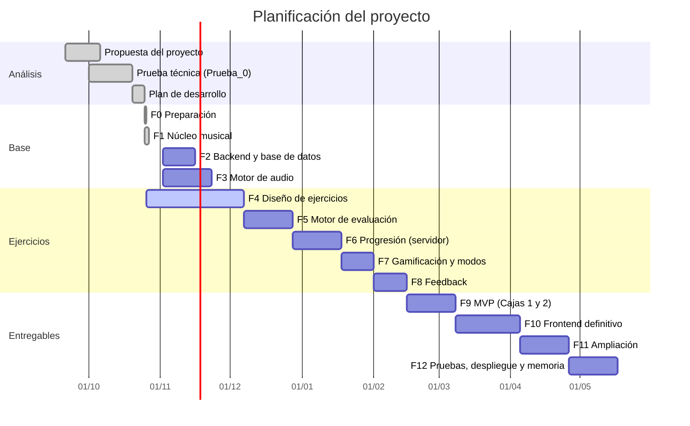
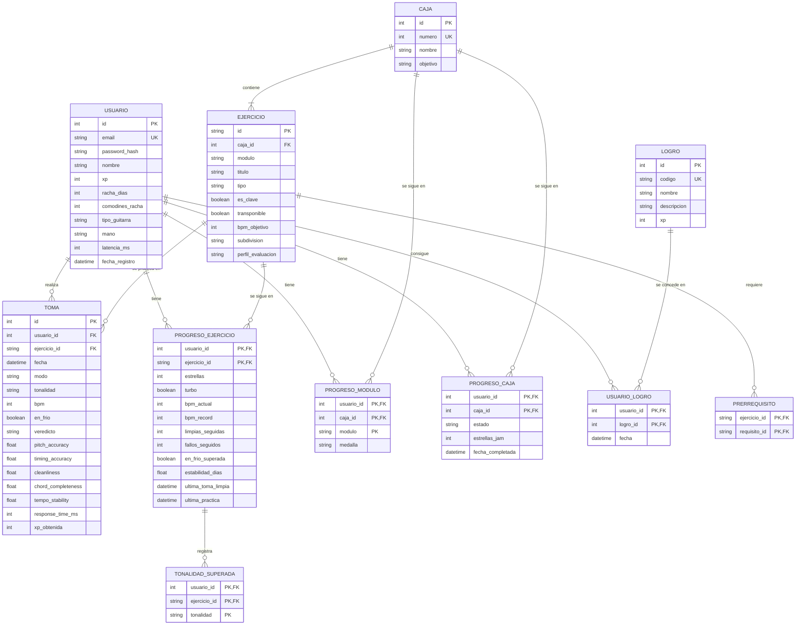
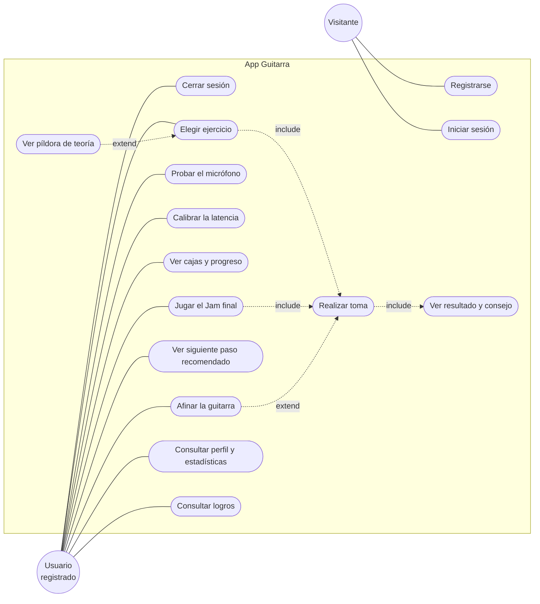
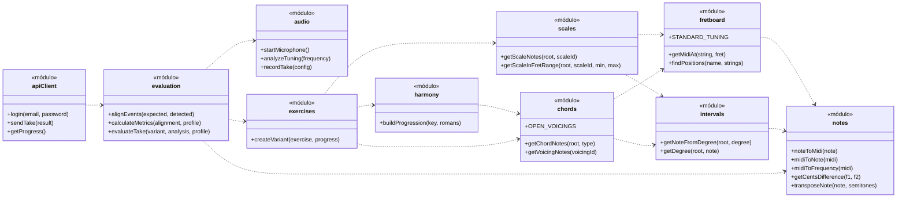
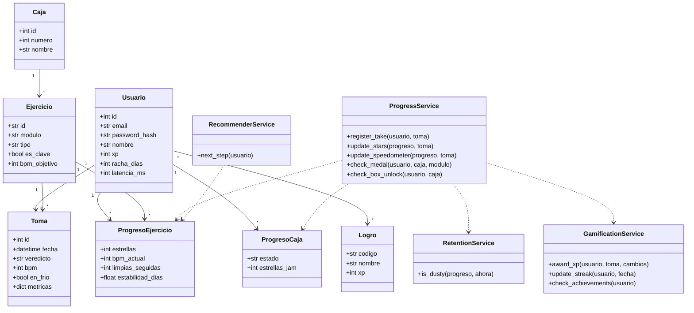
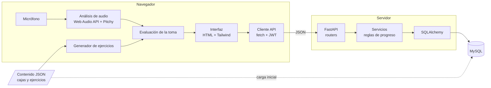
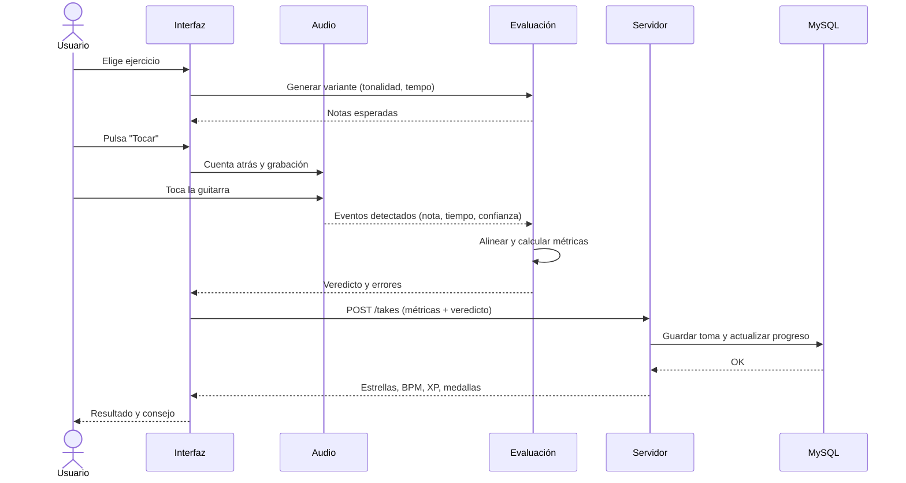

# App web para aprender a tocar la guitarra

**Entrega voluntaria de seguimiento. Proyecto Fin de Ciclo DAW**

<!-- Completar: nombre, tutor/a, centro, fecha de entrega -->
- Alumno: Jose Carlos Pecellin Martínez
- Ciclo: Desarrollo de Aplicaciones Web
- Fecha: octubre de 2026

> Esta entrega recoge el estado del proyecto en una fase temprana. Aquí se intenta recoger los puntos más importantes a tener en cuenta para estructurar y definir las reglas del proyecto, así como el marcar el objetivo claramente tras comparar con el estado del arte actual. El análisis y la planificación está sujeto a cambios o aportaciones por parte de la tutora, al igual que la arquitectura. La lógica musical básica está programada y probada en la parte de la API, pero el diseño visual definitivo y la mayor parte de la lógica de los ejercicios todavía están en desarrollo, por eso algunos apartados son provisionales.

---

## Índice

1. Introducción
   1. Motivación
   2. Abstract
   3. Objetivos
2. Estado del arte
3. Metodología utilizada
4. Tecnologías utilizadas
5. Planificación, diagnóstico y contexto laboral
6. Análisis del proyecto
   1. Requisitos funcionales
   2. Requisitos no funcionales
   3. Diagrama entidad-relación
   4. Diagramas de casos de uso
   5. Diagramas de clases
   6. Arquitectura y estructura del proyecto
7. Diseño, mockups y prototipos

---

## 1. Introducción

### 1.1 Motivación

En mis intentos de aprender la guitarra de forma autodidacta siempre me ha faltado una herramienta que siguiera mi progreso de cerca y que ordenara el aprendizaje de forma lógica. Los vídeos y las tablaturas enseñan *qué* tocar, pero no dicen si lo estás tocando bien y las posibilidades que hay suelen ser de pago. También la estructura de estas apps de guiarte a *reproducir* canciones casi tal cual son creadas, pero a mi lo que me interesaba siempre era aprender a comprender y estructurar una canción en mi cabeza para poder improvisar o comprenderla con tan solo escuchar algunas notas.

La idea del proyecto es una aplicación web que **escuche por el micrófono** lo que toca el usuario y le diga si lo ha hecho bien, con un sistema de niveles y recompensas que motive a practicar todos los días. El objetivo final no es reproducir canciones de memoria, sino llegar a **improvisar** con lo aprendido en cada nivel.

### 1.2 Abstract

*Resumen (español).* El proyecto consiste en una aplicación web de autoaprendizaje de guitarra con un enfoque gamificado:
- **Organización:** el contenido se divide en niveles ("cajas") y cada caja tiene tres módulos: oído y teoría, acordes y punteo.
- **Evaluación:** el navegador captura el sonido de la guitarra con la Web Audio API y evalúa si las notas, los acordes y el ritmo son correctos.
- **Progreso:** el servidor, desarrollado con Python y FastAPI, guarda el progreso en una base de datos MySQL y aplica las reglas de puntuación (estrellas, medallas, rachas y logros).
- **Avance:** para pasar de nivel hay que demostrar, tocando y a tempo, que se domina el nivel actual. Cada nivel termina con una improvisación sobre una base musical.

*Abstract (English).* This project is a web application for self-learning the guitar with a gamified approach:
- **Structure:** the content is organized into levels ("boxes"), each with three modules: ear training and theory, chords and lead guitar.
- **Assessment:** the browser captures the sound of the guitar using the Web Audio API and checks whether notes, chords and rhythm are played correctly.
- **Progress:** the server, built with Python and FastAPI, stores progress in a MySQL database and applies the scoring rules (stars, medals, streaks and achievements).
- **Unlocking levels:** to move to the next level the user must prove, by playing in time, that the current level is mastered. Each level ends with an improvisation over a backing track.

### 1.3 Objetivos

#### Objetivos generales

1. Desarrollar una aplicación web completa (frontend, backend y base de datos) que permita aprender guitarra de forma autónoma y guiada.
2. Implementar un sistema de reconocimiento de audio en tiempo real que evalúe la ejecución del usuario, tanto en notas sueltas como en acordes y cambios de acordes.
3. Aplicar mecánicas de gamificación que mejoren la motivación y la constancia en la práctica, sin castigar al usuario.

#### Objetivos específicos

- Registro y autenticación de usuarios con contraseñas cifradas y token de sesión.
- Afinador de guitarra y prueba de micrófono de acceso rápido.
- Ejercicios de los tres módulos (oído y teoría, acordes y punteo) corregidos automáticamente por micrófono.
- Sistema de progreso por niveles: estrellas por ejercicio, medallas por módulo y apertura de la siguiente caja al superar el Jam final.
- Sistema de repaso que detecte los ejercicios que el usuario lleva tiempo sin practicar.
- Gamificación: puntos de experiencia (XP), rachas de práctica y logros.
- Panel de perfil con historial y estadísticas de práctica.
- Pruebas unitarias de la lógica de análisis de audio y de las reglas de progreso.

---

## 2. Estado del arte

Existen varias aplicaciones para aprender guitarra. Las he agrupado según su enfoque:

| Aplicación | Tipo | Escucha al usuario | Puntos fuertes | Carencias respecto a mi idea |
|-----------|------|--------------------|----------------|------------------------------|
| **Yousician** | App gamificada | Sí, por micrófono | Muy completa, ejercicios con feedback en tiempo real | Centrada en seguir canciones y ejercicios marcados, poco enfoque en improvisar. Modelo de suscripción |
| **Simply Guitar** | App gamificada | Sí, por micrófono | Muy sencilla para principiantes | Contenido orientado sobre todo a los primeros pasos |
| **Rocksmith+** | Juego / app | Sí (cable o micrófono) | Aprender con canciones reales, formato videojuego | Orientado a tocar canciones, no a entender lo que se toca |
| **Fender Play** | Cursos en vídeo | No en su planteamiento principal | Lecciones de calidad, por estilos | No corrige lo que tocas |
| **JustinGuitar** | Curso web + app | Parcialmente | Método muy ordenado y gratuito en web | La práctica la tiene que autoevaluar el alumno |
| **GuitarTuna** | Afinador | Sí | Afinador muy preciso | Solo afinador y juegos sencillos |
| **Ultimate Guitar / Songsterr** | Tablaturas | No | Enorme catálogo de canciones | No enseñan ni evalúan |


**Qué aporta este proyecto frente a lo que existe:**

- **Diagnóstico de acordes cuerda a cuerda.** No solo dice si el acorde está bien, sino qué cuerda no ha sonado, y propone tocar el acorde nota a nota.
- **El objetivo es improvisar.** Cada nivel termina con un Jam en una tonalidad que elige la app, para comprobar que se ha aprendido la habilidad y no una forma de memoria.
- **Rigor sin castigos.** Para subir de nivel hay que tocar limpio y a tempo, incluso "en frío" otro día, pero no hay vidas ni se pierden estrellas.
- **Aplicación web.** Funciona en el navegador sin instalar nada y el audio no sale del ordenador del usuario.

---

## 3. Metodología utilizada

He elegido una **metodología iterativa e incremental**, adaptada a un proyecto de una sola persona:

- **Desarrollo por fases.** Cada fase termina con algo que funciona y se puede probar: primero la lógica musical, después el servidor, el audio, la evaluación… El plan completo está en el apartado 5.
- **Prueba técnica previa (Prueba_0).** Antes de empezar la aplicación hice una mini-aplicación con el afinador y el analizador de acordes, para comprobar que la detección por micrófono era viable. Es el principal riesgo técnico del proyecto y me ha permitido encontrar limitaciones a tener en cuenta para desarrollar y confrontar al MVP. Esta es que el micófono de los portátiles falla a la hora de detectar notas graves, cuestión normal en su fabricación y motivo por el que debo investigar hardware recomendado mínimo para mejorar experiencia.
- **Tablero de tareas.** Las tareas de cada fase se organizan en columnas: pendiente, en curso, hecho.
- **Pruebas unitarias desde el principio.** Toda la lógica que no depende del micrófono ni de la pantalla tiene tests automáticos: Vitest en el frontend y pytest en el backend.
- **Control de versiones con Git**, con commits pequeños y descriptivos.
- **Registro de decisiones.** Cada decisión técnica importante se apunta con su justificación.
- **Diseño de ejercicios mediante fichas.** La parte más compleja, cómo funciona cada tipo de ejercicio, se diseña primero en una ficha y se valida con la guitarra antes de programarla.

---

## 4. Tecnologías utilizadas

| Capa | Tecnología | Uso |
|------|-----------|-----|
| Frontend | HTML5, Tailwind CSS | Estructura y estilos |
| Frontend | JavaScript (módulos ES) | Interfaz, lógica de ejercicios y evaluación |
| Audio | Web Audio API | Captura del micrófono y análisis de frecuencias (FFT) |
| Audio | Pitchy | Detección de la nota en sonidos de una sola cuerda |
| Backend | Python 3.11 + FastAPI | API REST: usuarios, progreso, gamificación |
| Backend | SQLAlchemy | Acceso a la base de datos (ORM) |
| Base de datos | MySQL 8.0 | Persistencia |
| Pruebas | Vitest, pytest | Tests unitarios del frontend y del backend |
| Herramientas | Visual Studio Code, Vite, Postman, MySQL Workbench, Git | Desarrollo, servidor local, pruebas de la API, gestión de la base de datos y control de versiones |

**Justificación de las elecciones principales:**

- **Web Audio API:** es nativa del navegador, no requiere instalar nada y da acceso directo a los datos de frecuencia del micrófono.
- **Pitchy:** es la única librería externa de audio. Detectar con precisión la nota de una cuerda (sobre todo las graves) es complejo, y Pitchy lo resuelve de forma ligera. Los acordes se analizan con código propio sobre la ***Primera transformada de Fourier***
- **FastAPI:** cumple el mismo papel que Express o Django, pero trabaja de forma asíncrona de serie y valida los datos automáticamente con Pydantic. Está justificado en la propuesta del proyecto.
- **MySQL:** base de datos relacional que conozco del ciclo, con Workbench para gestionarla y para generar el diagrama entidad-relación.
- **Vite:** solo como servidor de desarrollo. El navegador solo permite usar el micrófono en `localhost` o con HTTPS.

**Reparto de la lógica:**
- **En el navegador:** el audio se analiza y se evalúa aquí, por velocidad y privacidad.
- **En el servidor:** el progreso se calcula aquí, para que el usuario no pueda manipular sus estrellas desde el navegador.

---

## 5. Planificación, diagnóstico y contexto laboral

### 5.1 Fases del proyecto

| Fase | Contenido | Estado |
|------|-----------|--------|
| 0 | Preparación: repositorio, estructura, entorno | Hecho |
| 1 | Núcleo musical: notas, mástil, escalas, acordes | Hecho |
| 2 | Backend base, base de datos y autenticación | Pendiente |
| 3 | Motor de audio: afinador, metrónomo, latencia, captura | Pendiente (parte validada en Prueba_0) |
| 4 | Diseño de los ejercicios (fichas) | En curso |
| 5 | Motor de evaluación de tomas | Pendiente |
| 6 | Progresión en el servidor: estrellas, medallas, cajas, repaso | Pendiente |
| 7 | Gamificación y modos de juego | Pendiente |
| 8 | Feedback al usuario | Pendiente |
| 9 | Contenido de las Cajas 1 y 2 → versión mínima completa (MVP) | Pendiente |
| 10 | Diseño definitivo del frontend | Pendiente |
| 11 | Ampliación: más modos y más cajas | Según el tiempo disponible |
| 12 | Pruebas finales, despliegue y memoria | Pendiente |

### 5.2 Diagrama de Gantt



Las fases 2, 3 y 4 se solapan: el servidor y el audio no dependen entre sí, y el diseño de los ejercicios es trabajo de análisis que se puede hacer en paralelo.

### 5.3 Diagnóstico (DAFO)

| | Positivo | Negativo |
|---|---|---|
| **Interno** | **Fortalezas:** conocimiento propio de la guitarra y de cómo se aprende; prueba técnica que demuestra que la detección funciona; tecnologías gratuitas | **Debilidades:** proyecto de una sola persona; la detección de acordes es imprecisa con algunos micrófonos; alcance amplio (8 niveles) |
| **Externo** | **Oportunidades:** mucha gente aprende guitarra por su cuenta con vídeos y no tiene feedback; el aprendizaje online y gamificado está en auge | **Amenazas:** existen aplicaciones grandes y consolidadas; la calidad del micrófono y el ruido de cada usuario no se pueden controlar |

**Cómo se mitigan los riesgos principales:**

- **Alcance:** la primera versión completa se limita a las Cajas 1 y 2. El resto del contenido se puede añadir sin tocar el código, porque está en ficheros de datos.
- **Detección:** cuando la app no está segura de lo que ha oído, pide repetir la toma en vez de dar un fallo injusto.

### 5.4 Contexto laboral

El proyecto se sitúa entre dos sectores:

- **Educación online (edtech).** Las plataformas de aprendizaje con gamificación (de idiomas, de programación o de música) se han consolidado como modelo de negocio, normalmente por suscripción.
- **Tecnología musical.** Afinadores, aplicaciones de práctica y herramientas para músicos que procesan audio en el navegador o en el móvil.

Desde el punto de vista profesional, el proyecto me permite trabajar el perfil de **desarrollador full stack**: frontend con JavaScript, API REST con Python, base de datos relacional, autenticación y pruebas automáticas. Además añade una parte menos habitual, el procesamiento de audio en el navegador, que es útil en empresas de contenido multimedia, educación o música.

---

## 6. Análisis del proyecto

### 6.1 Requisitos funcionales

| ID | Requisito | Prioridad |
|----|-----------|-----------|
| RF01 | El usuario puede registrarse con correo y contraseña | Alta |
| RF02 | El usuario puede iniciar y cerrar sesión | Alta |
| RF03 | La app ofrece un afinador que indica en tiempo real si la cuerda está afinada y hacia dónde corregir | Alta |
| RF04 | La app permite probar el micrófono (nivel de señal y ruido de fondo) | Alta |
| RF05 | La app calibra la latencia del audio del usuario | Alta |
| RF06 | El usuario ve las cajas (niveles) con su estado y progreso | Alta |
| RF07 | Dentro de una caja, el usuario elige un módulo (oído y teoría, acordes, punteo) y un ejercicio | Alta |
| RF08 | El usuario realiza una toma de un ejercicio y la app la evalúa por micrófono | Alta |
| RF09 | Tras cada toma, la app muestra el resultado y un consejo sobre el error principal | Alta |
| RF10 | El servidor actualiza las estrellas del ejercicio según las reglas de progreso | Alta |
| RF11 | Se concede una medalla de módulo cuando se cumplen sus condiciones | Alta |
| RF12 | El Jam final se desbloquea con las 3 medallas de la caja, y superarlo abre la caja siguiente | Alta |
| RF13 | El tempo de los ejercicios sube con las tomas limpias (velocímetro) | Media |
| RF14 | La app recomienda el siguiente ejercicio a practicar | Media |
| RF15 | La app marca con "polvo" los ejercicios que hace tiempo que no se practican | Media |
| RF16 | El usuario gana XP, mantiene rachas de práctica y desbloquea logros | Media |
| RF17 | El usuario consulta su perfil: historial, estadísticas y logros | Media |
| RF18 | Cada ejercicio muestra una píldora de teoría opcional ("¿Y esto por qué?") | Baja |
| RF19 | Modos de juego adicionales: entreno rápido, desempolvar, retos | Baja |
| RF20 | Los usuarios que ya saben tocar pueden saltar niveles superando sus Jams (reto de salto) | Baja |

### 6.2 Requisitos no funcionales

| ID | Requisito |
|----|-----------|
| RNF01 | **Seguridad:** contraseñas guardadas con hash (bcrypt) y rutas privadas protegidas con token JWT |
| RNF02 | **Privacidad:** el audio del micrófono se procesa en el navegador y nunca se envía al servidor |
| RNF03 | **Integridad:** el progreso (estrellas, medallas, XP) se calcula en el servidor, no en el cliente |
| RNF04 | **Rendimiento:** el afinador responde en tiempo real, con un retraso apreciable inferior a medio segundo |
| RNF05 | **Compatibilidad:** funciona en las versiones actuales de Chrome, Firefox y Edge de escritorio |
| RNF06 | **Requisito del navegador:** la app se sirve por HTTPS (o `localhost` en desarrollo), sin lo cual no se puede usar el micrófono |
| RNF07 | **Usabilidad:** sesiones cortas útiles (5 minutos ya permiten avanzar) y mensajes cercanos, no técnicos |
| RNF08 | **Robustez:** si la detección no es fiable (ruido, señal débil), la toma se marca como no concluyente y no penaliza |
| RNF09 | **Mantenibilidad:** el contenido (niveles, ejercicios, textos) está en ficheros de datos separados del código |
| RNF10 | **Calidad:** la lógica de audio, de evaluación y de progreso tiene pruebas unitarias |
| RNF11 | **Diseño adaptable:** la interfaz se adapta a portátil y tablet |

### 6.3 Diagrama entidad-relación



**Notas del modelo:**

- Las cuatro tablas de la propuesta (`usuarios`, `ejercicios`, `progreso`, `logros`) se han ampliado al analizar las reglas de progreso.
- **`TOMA`** guarda cada intento con sus métricas. Hace falta para calcular rachas de tomas limpias, mostrar el historial y diagnosticar errores repetidos.
- **`PROGRESO_EJERCICIO`** guarda el estado actual de cada ejercicio para cada usuario, para no tener que recalcularlo desde todas las tomas cada vez.
- **`TONALIDAD_SUPERADA`** es una tabla aparte porque un ejercicio puede superarse en varias tonalidades. Guardarlas en una sola columna de texto rompería la primera forma normal.
- **`PRERREQUISITO`** es una relación reflexiva de `EJERCICIO` consigo mismo (muchos a muchos).
- El Jam final de cada caja se guarda como un `EJERCICIO` de tipo `jam`.
- El contenido (`CAJA`, `EJERCICIO`, `LOGRO`) se carga en la base de datos desde ficheros JSON.


### 6.4 Diagramas de casos de uso

**Diagrama general**



- **CU04 extiende CU09:** si la guitarra está desafinada, antes de la toma se abre el afinador.
- **CU15 extiende CU08:** la píldora de teoría es opcional.

**Detalle del caso de uso principal: CU09 Realizar toma**

| Campo | Descripción |
|-------|-------------|
| Actor | Usuario registrado |
| Precondiciones | Sesión iniciada, permiso de micrófono concedido, latencia calibrada (si el ejercicio va a tempo) |
| Flujo principal | 1. El usuario elige un ejercicio.<br>2. La app genera la variante (tonalidad, tempo) y muestra qué hay que tocar.<br>3. Cuenta atrás de un compás con el metrónomo.<br>4. La app graba y analiza el sonido.<br>5. La app compara lo tocado con lo esperado y calcula las métricas.<br>6. La app envía el resultado al servidor.<br>7. El servidor actualiza estrellas, tempo, XP y medallas.<br>8. La app muestra el resultado y un consejo |
| Flujos alternativos | 4a. Mucho ruido o señal débil → toma no concluyente: no cuenta y se pide repetir.<br>4b. Guitarra desafinada → se abre el afinador.<br>5a. Tres tomas fallidas seguidas → modo rescate (se practica solo el compás que falla) |
| Postcondiciones | La toma queda guardada y el progreso actualizado |

### 6.5 Diagramas de clases

El frontend está escrito en JavaScript con **módulos** (ficheros que exportan funciones) en lugar de clases. Por eso hay dos diagramas:

- **Módulos del frontend:** representan cada fichero como una caja con sus funciones principales.
- **Modelo del backend:** las clases de SQLAlchemy y los servicios.

**Frontend: módulos principales**



Los módulos `notes`, `fretboard`, `intervals`, `scales`, `chords` y `harmony` ya están programados y probados. El resto está pendiente y sus funciones pueden cambiar.

**Backend: modelo de datos y servicios**



### 6.6 Arquitectura y estructura del proyecto

**Arquitectura general**



**Secuencia de una toma**



**Estructura de carpetas**

```
frontend/
  src/music/        teoría musical (notas, mástil, escalas, acordes)
  src/audio/        micrófono, afinador, metrónomo, latencia
  src/exercises/    generación de ejercicios
  src/evaluation/   comparación de lo tocado con lo esperado
  src/feedback/     mensajes al usuario
  src/api/          comunicación con el servidor
  src/ui/           pantallas
  tests/
backend/
  app/routers/      endpoints
  app/models/       tablas (SQLAlchemy)
  app/schemas/      validación de datos (Pydantic)
  app/services/     reglas de negocio
  tests/
content/            niveles, ejercicios y textos en JSON
docs/               decisiones, fichas de ejercicios y memoria
```

---

## 7. Diseño, mockups y prototipos

> El diseño visual definitivo está previsto para la Fase 10. Mi tarea actual está siendo pensar y crear la lógica de cómo se van a estructurar los ejercicios, qué van a pedir, etc. Al no tener conocimientos musicales es el aspecto que más me va a costar del proyecto y dónde más energía estoy poniendo.

- Se muestra el mástil con una pista de la zona.
- El usuario pasa a la siguiente pregunta pulsando un botón.
- Si toca la nota correcta en otra octava, cuenta como fallo, pero se explica: se le indica que ha acertado la nota y en qué octava estaba la que se pedía, mostrando las dos posiciones en el mástil.


### 7.5 Prototipo funcional: Prueba_0

Como prototipo técnico he desarrollado una mini-aplicación con interfaz mínima. Tiene dos modos:

- **Afinador:** detecta la cuerda que suena y si está afinada, alta o baja, con la desviación en cents.
- **Analizador de acordes:** a partir de un acorde elegido (Mi, La menor, Re, Sol, Do), indica qué cuerdas suenan y cuáles faltan.

Este prototipo ha servido para comprobar que la detección por micrófono es viable con la Web Audio API y para conocer sus limitaciones. Por ejemplo, cuando una nota coincide con un armónico de otra cuerda más grave, la detección se puede confundir.
